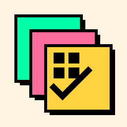

<p align="center">
  
</p>

# designsense

> UI/UX principles and style plugin for AI coding agents. Write accessible, consistent front-end code — every time.

## Why designsense?

AI agents generate working code but often miss:
- **Accessibility** (contrast, focus, labels, keyboard nav)
- **Interaction states** (loading, empty, error, disabled)
- **Design consistency** (magic numbers, hardcoded colors, spacing)
- **Responsive behavior** (mobile-first, fluid layouts)

designsense adds **always-on rules** + **optional visual styles** so agents produce production-ready UI by default.

## Features

| Feature | Description |
|---------|-------------|
| **5 Principle Pillars** | Hierarchy, Heuristics, A11y, States, Responsiveness |
| **3 Levels** | `lite` (A11y only), `full` (all pillars), `strict` (enforce tokens) |
| **Style Presets** | 59 presets across 8 categories |
| **Deterministic Checks** | Contrast, A11y scan, Smell lint, Style fidelity |
| **Token-First** | Design tokens → framework output (Tailwind, CSS, CSS-in-JS, shadcn) |
| **Multi-Agent** | Claude Code, Codex, Gemini, OpenCode, Kiro |

## Supported Agents

| Agent | Adapter | Installed Location |
|-------|---------|--------------------|
| Claude Code | `.claude-plugin/` | `~/.claude/plugins/designsense/` |
| OpenCode | `.opencode/plugins/designsense.mjs` | `~/.opencode/plugins/` |
| Kiro | `.kiro/steering/designsense.md` | `~/.kiro/steering/` |
| Gemini CLI | `gemini-extension.json` | `~/.gemini/extensions/designsense/` |
| Codex / Cursor / Windsurf | `AGENTS.md` | Project root |

## Quick Start

### Get the repo
```bash
git clone https://github.com/Luigibarte4563/designsense.git
cd designsense
```

### Install (any compatible agent)
```bash
# Auto-detect and install for all detected agents
node scripts/install.js

# Target one agent
node scripts/install.js --agent=claude

# Force install / preview first
node scripts/install.js --agent=gemini --force
node scripts/install.js --dry-run

# Or via npm scripts
npm run install:designsense
npm run install:all
```

Detects Claude Code, OpenCode, Kiro, Gemini CLI, and Codex/Cursor/Windsurf; writes each adapter to its native config directory plus `.designsense/style.json`. See the [full install matrix](#supported-agents) below.

### Install (Claude Code, manual)
```bash
# From marketplace
/plugin marketplace add Luigibarte4563/designsense
/plugin install designsense@designsense

# Or manual
cp -r designsense/.claude-plugin ~/.claude/plugins/designsense
```

### Manual install (per agent)
If you prefer not to use the installer, copy the adapter files yourself:

| Agent | Manual step | Verify |
|-------|-------------|--------|
| **Claude Code** | `cp -r designsense/.claude-plugin ~/.claude/plugins/designsense` | `/designsense-help` |
| **OpenCode** | `cp designsense/.opencode/plugins/designsense.mjs ~/.opencode/plugins/` | Plugin auto-loads on restart |
| **Kiro** | `cp designsense/.kiro/steering/designsense.md ~/.kiro/steering/` | Rules appear in Kiro context |
| **Gemini CLI** | Copy `gemini-extension.json` and `.claude-plugin/` into `~/.gemini/extensions/designsense/`, plus a `gemini-extension.js` entry point | `/designsense-help` |
| **Codex / Cursor / Windsurf** | `cp designsense/AGENTS.md ./AGENTS.md` in your project root | Rules auto-load from `AGENTS.md` |

### Uninstall
```bash
node scripts/uninstall.js              # all agents
node scripts/uninstall.js --agent=kiro # one agent
node scripts/uninstall.js --dry-run    # preview
```

### Configure
```bash
# Project config (commits with repo for team consistency)
mkdir -p .designsense
cat > .designsense/style.json <<EOF
{ "level": "full", "style": "neobrutalism" }
EOF

# Or env vars
export DESIGNSENSE_MODE=full
export DESIGNSENSE_STYLE=neobrutalism
```

### Use
```bash
# Set level
/designsense full

# Review current diff
/designsense-review

# Audit whole repo
/designsense-audit

# Switch style
/designsense-style glassmorphism

# Preview style
/designsense-style-preview
```

## Commands

| Command | Purpose |
|---------|---------|
| `/designsense [lite|full|strict]` | Set principles level |
| `/designsense-review` | Review diff → severity-ranked fixes |
| `/designsense-audit [path]` | Full repo/page audit |
| `/designsense-a11y [path]` | Focused accessibility pass |
| `/designsense-tokens [path]` | Extract hardcoded values → token file |
| `/designsense-states [path]` | Find missing loading/empty/error states |
| `/designsense-style` | List styles |
| `/designsense-style <name>` | Activate style |
| `/designsense-style mix <a>+<b>` | Blend primary + accent |
| `/designsense-style off` | Principles only |
| `/designsense-style-preview` | Generate HTML showcase |
| `/designsense-help` | Show this reference |

**Invocation by agent:**
- **OpenCode / Gemini CLI:** `/designsense-review` (exact names above)
- **Claude Code:** namespaced as `/designsense:designsense-review`, `/designsense:designsense-style`, etc.
- **Kiro / Codex / Cursor / Windsurf:** no slash commands; the rules are always in context via `designsense.md` / `AGENTS.md`

## Style Presets (59 Total)

Run `/designsense-style` to list all available styles.

### Depth & Surface (10)
| Style | Signature |
|-------|-----------|
| **flat-design** | Solid colors, no shadows/gradients |
| **semi-flat** | Flat with subtle shadows (1-12px) |
| **material-design** | Elevation levels, ripple, tonal palette |
| **skeuomorphism** | Realistic gradients, textures, 3D depth |
| **neumorphism** | Soft extruded, dual shadows (light/dark) |
| **claymorphism** | Puffy 3D shapes, large radius, soft shadows |
| **glassmorphism** | Frosted translucent, backdrop blur, gradients |
| **liquid-glass** | Fluid glass, refraction, high transparency |
| **aurora** | Blurred mesh gradients behind content |
| **gradient-heavy** | Bold gradients/duotone everywhere |

### Bold & Raw (6)
| Style | Signature |
|-------|-----------|
| **brutalism** | Stark, raw, system fonts, no decoration |
| **anti-design** | Deliberately chaotic, clashing, rule-breaking |
| **maximalism** | Dense, layered, colorful, pattern-filled |
| **memphis** | 80s geometric shapes, squiggles, bright pastels |
| **pop-art** | Halftone dots, thick black outlines, primary colors |
| **grunge** | Torn textures, rough edges, dark moody palette |

### Minimal & Structured (7)
| Style | Signature |
|-------|-----------|
| **swiss** | Strict grid, big type, black/white/accent, asymmetric |
| **bento-grid** | Modular rounded tiles in structured grid |
| **monochrome** | Single hue, tonal variations only |
| **typographic** | Type as hero, extreme scale, minimal color |
| **editorial** | Serif headings, wide margins, magazine layout |
| **corporate** | Neutral, dense, table/form friendly, blue-gray |
| **scandinavian** | Calm, light, natural tones, functional |

### Retro & Nostalgic (12)
| Style | Signature |
|-------|-----------|
| **retro-vintage** | Muted earth tones, paper texture, serif type |
| **y2k** | Glossy bubbles, chrome, aqua/magenta, chrome |
| **frutiger-metro** | Web 2.0 gloss, reflections, rounded, badges |
| **vaporwave** | Pink/cyan gradients, grids, statues, glitch |
| **synthwave** | Neon sunsets, dark purple grids, palm silhouettes |
| **windows95** | Beveled gray, teal bg, MS Sans Serif, classic OS |
| **pixel-art** | 16-color palette, bitmap fonts, hard edges |
| **terminal** | Green-on-black, monospace, command-line |
| **art-deco** | Gold accents, geometric symmetry, dark navy |
| **art-nouveau** | Organic curves, floral motifs, earthy palette |
| **bauhaus** | Primary colors only, geometric shapes, functional |
| **mid-century** | Warm earth tones, teak/mustard/olive, organic |

### Dark & Futuristic (5)
| Style | Signature |
|-------|-----------|
| **dark-oled** | True black (#000), desaturated pastel accents |
| **cyberpunk** | Near-black, neon pink/cyan/yellow, glitch |
| **futuristic-hud** | Thin lines, cyan/magenta holographic, transparent |
| **techno-glitch** | RGB shift, scanlines, digital artifacts, jittery |
| **space-cosmic** | Deep gradients, stars, nebulae, slow majestic motion |

### Organic & Playful (8)
| Style | Signature |
|-------|-----------|
| **organic-blob** | Fluid asymmetric shapes, morphing, warm palette |
| **hand-drawn** | Sketch fonts, wobbly lines, paper texture |
| **illustrated** | Custom illustrations as identity, storybook |
| **paper-cutout** | Layered paper shadows, warm natural tones |
| **kawaii** | Pastels, pill shapes, cute chars, bouncy animation |
| **isometric** | 3D isometric, three-tone shading, technical |
| **biophilic** | Earthy greens/browns, leaf/wood textures, calm |
| **pastel-soft** | Low saturation, high lightness, very round |

### Cultural & Thematic (5)
| Style | Signature |
|-------|-----------|
| **wabi-sabi** | Imperfection, asymmetry, natural materials, calm |
| **neo-tokyo** | Vivid magenta/cyan/yellow, manga layouts, dynamic |
| **gothic** | Dark moody, ornate serif, blood red + gold |
| **luxury** | Black + gold, elegant serif, generous spacing |
| **industrial** | Blueprint grid, monospace, technical lines |

### Interaction-Led (4)
| Style | Signature |
|-------|-----------|
| **motion-first** | Animation drives design, spring physics, choreography |
| **parallax** | Layered depth on scroll, narrative storytelling |
| **spatial-ar** | Floating glass panels, depth layers, visionOS style |
| **voice-ui** | Chat bubbles, minimal visuals, voice state indicators |

### Original MVP (3)
| Style | Signature |
|-------|-----------|
| **neobrutalism** | 3px black borders, 4px hard shadows, flat saturated colors |
| **glassmorphism** | Translucent panels, backdrop blur, light borders |
| **minimalism** | Whitespace, restrained palette, content-first |

---

### Quick Reference: All Styles by Category

```
Depth & Surface:          flat-design, semi-flat, material-design, skeuomorphism,
                          neumorphism, claymorphism, glassmorphism, liquid-glass,
                          aurora, gradient-heavy

Bold & Raw:               brutalism, anti-design, maximalism, memphis, pop-art, grunge

Minimal & Structured:     swiss, bento-grid, monochrome, typographic, editorial,
                          corporate, scandinavian

Retro & Nostalgic:        retro-vintage, y2k, frutiger-metro, vaporwave, synthwave,
                          windows95, pixel-art, terminal, art-deco, art-nouveau,
                          bauhaus, mid-century

Dark & Futuristic:        dark-oled, cyberpunk, futuristic-hud, techno-glitch, space-cosmic

Organic & Playful:        organic-blob, hand-drawn, illustrated, paper-cutout,
                          kawaii, isometric, biophilic, pastel-soft

Cultural & Thematic:      wabi-sabi, neo-tokyo, gothic, luxury, industrial

Interaction-Led:          motion-first, parallax, spatial-ar, voice-ui
```

## Non-Negotiables (Every Level, Every Style)

- ✅ Contrast ≥ 4.5:1 (text), 3:1 (UI)
- ✅ Visible focus ring on every interactive element
- ✅ Semantic HTML, labels on inputs
- ✅ 44×44px touch targets
- ✅ Loading / empty / error states on async UI
- ✅ `prefers-reduced-motion` respected
- ✅ Header/nav stays visible while scrolling (`position: sticky; top: 0`)
- ✅ No `outline: none` without replacement
- ✅ No click handlers on `<div>`/`<span>` without role+tabindex

## How It Works

### 1. Hook Injection
`UserPromptSubmit` hook loads core rules + active style's STYLE.md into context.

### 2. Token-First Generation
Agent defines tokens first, builds components from tokens.

### 3. Lint on Edit
`PostToolUse` hook runs smell-lint + style-fidelity after UI file edits.

### 4. On-Demand Review
`/designsense-review` runs full check suite on current diff.

### 5. Style Switching
Change tokens, not components. `/designsense-style glassmorphism` updates config; components auto-adapt.

## Framework Output

| Framework | Integration |
|-----------|-------------|
| **Tailwind** | Preset config + utility classes (`ds-btn`, `ds-card`) |
| **Plain CSS** | CSS variables (`--ds-color-primary`, `--ds-shadow-default`) |
| **CSS Modules** | Import CSS variables, use in modules |
| **Styled Components** | Theme object from tokens |
| **Emotion** | Theme object from tokens |
| **Stitches** | Theme config from tokens |
| **Panda CSS** | Token config from tokens |
| **shadcn/ui** | Theme override from tokens |
| **MUI/Chakra** | Theme override from tokens |

## Project Structure

```
designsense/
├── .claude-plugin/          # Claude Code plugin
│   ├── plugin.json
│   ├── hooks/               # inject-rules.js, post-edit-check.js
│   ├── commands/            # designsense-*.js
│   └── skills/              # SKILL.md files
├── styles/
│   ├── _template/           # Style template
│   ├── neobrutalism/        # STYLE.md, tokens.json, css-variables.css, tailwind.preset.js
│   ├── glassmorphism/
│   ├── minimalism/
│   └── ... (56 more presets)
├── scripts/                 # contrast-check.js, a11y-scan.js, smell-lint.js, style-fidelity.js, generate-styles.js
├── references/              # heuristics.md, wcag-checklist.md, component-patterns.md, stack-notes/
├── benchmarks/              # promptfooconfig.yaml
└── README.md
```

## Creating Custom Styles

```bash
/designsense-style-create
# Guided wizard:
# 1. Name your style
# 2. Choose base traits (borders, shadows, radius, colors)
# 3. Define tokens interactively
# 4. Generates styles/your-style/ with all formats
```

Or manually:
```bash
cp -r styles/_template styles/my-style
# Edit STYLE.md, tokens.json, css-variables.css, tailwind.preset.js
```

## Config Priority
1. Env vars: `DESIGNSENSE_MODE`, `DESIGNSENSE_STYLE`
2. User config: `~/.config/designsense/config.json`
3. Project config: `.designsense/style.json` (commit for team sync)

## Benchmarks

```bash
# Run promptfoo benchmarks
cd benchmarks
npx promptfoo eval -c promptfooconfig.yaml
```

Metrics measured:
- Axe violations (should be 0)
- States covered (loading/empty/error)
- Tokens vs hardcoded values ratio
- Keyboard operability
- Style fidelity score
- Files changed when switching styles (fewer = better)
- Token/time overhead

## Contributing

1. Add style preset in `styles/new-style/`
2. Run contrast check: `node scripts/contrast-check.js new-style`
3. Run style fidelity: `node scripts/style-fidelity.js new-style`
4. Add benchmark prompts in `benchmarks/prompts/`
5. Submit PR

## License

MIT